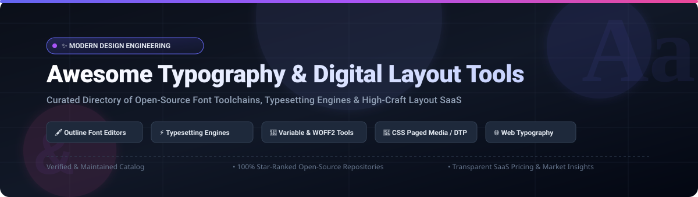

# Awesome-Typography-Digital-Layout-Tools 🖋️✨

  

  
  
  
  
  
  

---

## 📖 Top Typography & Digital Layout Tools Ecosystem

**Curated Directory of SaaS Products, Font Engineering Toolchains & Open-Source GitHub Projects** 🌟  
*Focused on Open-Source Font Editors, High-Performance Typesetting Engines, Web Typography Toolkits, Font Subsetting, Variable Fonts, and Digital Publishing Systems.*

**Last updated: November 2026**

This repository (`Awesome-Typography-Digital-Layout-Tools`) tracks notable **SaaS/Hosted platforms** and **open-source projects** for **Typography & Digital Layout Tools** — comprehensive resources for type designers, editorial layout specialists, frontend engineers, and creative directors. These tools empower creators to design and compile OpenType/Variable fonts, optimize WOFF2 web typography with automated subsetting, pair typefaces with deep learning, typeset multi-column publications and academic manuscripts, and manage global enterprise font licensing.

Contributions welcome! Open a PR to add or update entries.

---

## 📑 Table of Contents

- [📊 Sector Overview & Market Dynamics](#-sector-overview--market-dynamics)
- [☁️ SaaS & Hosted Platforms](#️-saas--hosted-platforms)
- [💻 Open-Source GitHub Projects](#-open-source-github-projects)
- [📈 Star History](#-star-history)
- [💖 Support & Sponsorship](#-support--sponsorship)
- [🤝 How to Contribute](#-how-to-contribute)
- [📜 Disclaimer](#-disclaimer)

---

## 📊 Sector Overview & Market Dynamics

The global typography, font licensing, and digital desktop publishing (DTP) software sector represents an estimated market size of approximately **$4.2 billion to $5.5 billion annually**, projected to expand at an 8.6% CAGR through 2030 driven by multi-channel digital publishing, cloud design platforms, and responsive web typography.

Market dynamics reflect a **moderately concentrated yet bifurcated market**: the enterprise font licensing and commercial desktop publishing segments are concentrated among dominant market leaders (Alphabet/Google Fonts, Adobe Creative Cloud, Monotype, and Canva), while the font design tool, micro-typography, variable font optimization, and indie foundry ecosystem remains highly fragmented with specialized independent studios and open-source toolchains driving cutting-edge format standards (WOFF2, UFO, HarfBuzz, Typst).

---

## ☁️ SaaS & Hosted Platforms

The table below lists leading commercial SaaS and hosted platforms for typography, font management, AI type pairing, and digital publication layout, sorted in descending order by estimated company valuation / annual revenue scale.

| Platform | Category / Use Case | Starting Tier Pricing | Free Tier / Trial Limit | Scale (Est. Valuation / Revenue) |
| :--- | :--- | :--- | :--- | :--- |
| **[Google Fonts](https://fonts.google.com)** | Cloud Font Delivery CDN & Directory | **$0.00 / mo** (100% free open-source font service) | Free forever without bandwidth, API, or pageview caps across entire 1,700+ font catalog | **~$2.1T Valuation** (Alphabet Inc. parent company) |
| **[Adobe Fonts](https://fonts.adobe.com)** | Enterprise Creative Cloud Font Sync & Web CDN | **$9.99 / mo** (Creative Cloud Single App Photography / InDesign plan at $22.99/mo) | Free tier available via basic Adobe ID with access to 1,000+ fonts; unlimited web pageviews | **~$210B Valuation** (Adobe Inc. NASDAQ: ADBE) |
| **[Canva](https://www.canva.com)** | Cloud Digital Layout & Multi-Page Publishing Suite | **$14.99 / mo** (Canva Pro, billed monthly or $120/yr) | Free forever tier with 5 GB cloud storage, 1M+ stock assets, and core layout tools; 30-day Pro trial | **~$32B Valuation** (Private market valuation) |
| **[Monotype Fonts](https://www.monotype.com)** | Enterprise Font Licensing & Inventory Management | **$99.00 / yr** (~$8.25/mo for individual desktop prototyping license) | 14-day free trial with unlimited prototyping access to 150,000+ fonts for mockup testing | **~$1.2B Valuation** (Acquired by HGGC / Private Equity) |
| **[Glyphs App](https://glyphsapp.com)** | Professional macOS Font Editor & Variable Font Suite | **€299.00 one-time** (~$325 one-time perpetual license, or €99 Mini edition) | 30-day fully functional unrestricted free trial with complete OpenType/variable export | **~$25M - $50M Valuation** (Privately held bootstrap leader) |
| **[FontBase](https://fontba.se)** | Cross-Platform Desktop Font Manager & Organizer | **$3.00 / mo** (or $29/yr or $180 lifetime Awesome license) | Free forever core desktop font activation, tagging, and Google Fonts sync with no font count limit | **~$5M - $10M Valuation** (Privately held / Dominik Levitsky Studio) |
| **[Fontself](https://www.fontself.com)** | Font Creation Plugin for Adobe Illustrator / Photoshop & iPad | **$39.00 one-time** (Fontself for iPad) or **$89.00 one-time** (Illustrator/PS Mac+Win) | No free forever tier; 14-day money-back guarantee with sample demo glyph export templates | **~$3M - $8M Valuation** (Privately held bootstrap studio) |
| **[Calligraphr](https://www.calligraphr.com)** | Handwriting-to-Font Converter & Template Builder | **$8.00 / mo** (Pro monthly subscription or $4/mo upgraded 6-month plan) | Free forever plan with up to 75 characters per font, 2 fonts stored simultaneously, no ligatures | **~$2M - $5M Valuation** (Bootstrapped indie business) |
| **[Fontstand](https://fontstand.com)** | Desktop & Web Font Discovery & Monthly Rental | **$2.00 / mo** (Rent-to-own starting tier per font style; rent 12 months to own perpetual) | Free 3-hour test drive per font style per day across desktop apps; 30-day free testing for students | **~$2M - $5M Valuation** (Privately held Dutch foundry platform) |
| **[Fontjoy](https://fontjoy.com)** | AI Deep-Learning Font Pairing & Typographic Contrast Generator | **$0.00 / mo** (Free web utility supported by community sponsorships) | Free forever without registration, rate limits, or usage caps | **<$1M Valuation** (Independent creator Jack Qiao) |
| **[Typewolf](https://www.typewolf.com)** | Curated Web Typography Showcase & Font Pairing Guides | **$39.00 one-time** (Typography handbook and curated font pairing guides) | Free forever access to all web inspiration specimens, lookbooks, and daily font recommendations | **<$1M Valuation** (Independent publisher Jeremiah Shoaf) |

---

## 💻 Open-Source GitHub Projects

The table below catalogs active, battle-tested open-source repositories powering modern digital typesetting, font engineering, outline rasterization, and responsive web typography. Each project includes a real-time star badge linking directly to its stargazer community, ranked in descending order by total GitHub star count.

| Project & Repository | GitHub Stars | Primary Language / Stack | Description & Core Capabilities |
| :--- | :--- | :--- | :--- |
| **[Fira Code](https://github.com/tonsky/FiraCode)** |  | Clojure / FontTools | Free monospaced font with programming ligatures for ASCII character combinations (`=>`, `===`, `!=`), OpenType stylistic sets, and variable font support. |
| **[Typst](https://github.com/typst/typst)** |  | Rust | Next-generation, blazingly fast markup-based typesetting system built as a programmable modern alternative to LaTeX for research papers, books, and reports. |
| **[Cascadia Code](https://github.com/microsoft/cascadia-code)** |  | Python / FontTools | Modern open-source monospaced variable font by Microsoft designed for command-line interfaces, code editors, and Terminal development with programming ligatures. |
| **[Iosevka](https://github.com/be5invis/Iosevka)** |  | JavaScript / Node.js | Slender, highly customizable open-source typeface generator with infinite stylistic options for coding, terminal emulators, and technical document typesetting. |
| **[Google Fonts Catalog](https://github.com/google/fonts)** |  | Python / FontTools | Official upstream open-source repository hosting complete source files, variable font axes, glyph designs, and OFL binaries for the worldwide Google Fonts collection. |
| **[Inter](https://github.com/rsms/inter)** |  | Python / UFO / Glyphs | Industry-standard open-source variable typeface meticulously crafted by Rasmus Andersson for high-legibility computer screens, user interfaces, and mobile applications. |
| **[Hack](https://github.com/source-foundry/Hack)** |  | Python / Shell | Handcrafted open-source typeface workhorse designed for source code reading, monospace terminals, and clear visual differentiation of easily confused glyphs. |
| **[Marp](https://github.com/marp-team/marp)** |  | TypeScript / CSS | Markdown-driven presentation slide deck and layout framework converting standard Markdown files into elegant PDF, PPTX, and HTML slide presentations. |
| **[WeasyPrint](https://github.com/Kozea/WeasyPrint)** |  | Python / CSS | Visual document publishing and HTML/CSS-to-PDF rendering engine with comprehensive W3C CSS Paged Media support for invoices, tickets, and multi-page books. |
| **[FontForge](https://github.com/fontforge/fontforge)** |  | C / Python | The venerable open-source vector outline font editor for Linux, Windows, and macOS supporting PostScript, TrueType, OpenType, CID-keyed, and SVG font creation. |
| **[Fontsource](https://github.com/fontsource/fontsource)** |  | TypeScript / Monorepo | Monorepo packaging over 1,500 open-source and Google fonts into self-hosted, versioned npm packages to eliminate render-blocking external CDN requests. |
| **[HarfBuzz](https://github.com/harfbuzz/harfbuzz)** |  | C / C++ | The quintessential open-source text shaping engine transforming Unicode strings into positioned glyphs across Android, Chromium, Firefox, GNOME, and TeX engines. |
| **[FontTools](https://github.com/fonttools/fonttools)** |  | Python / Cython | Premier Python library and command-line toolchain (`ttx`, `pyftsubset`, `varLib`) for manipulating, subsetting, and compiling OpenType, TTF, and Variable fonts. |
| **[opentype.js](https://github.com/opentypejs/opentype.js)** |  | JavaScript / HTML5 Canvas | Pure JavaScript parser and writer for OpenType and TrueType fonts providing direct browser and Node.js access to Bézier glyph vector curves and metrics. |
| **[Source Sans](https://github.com/adobe-fonts/source-sans)** |  | PostScript / UFO | Adobe's premier open-source sans serif typeface family designed by Paul D. Hunt for user interface environments and legible multi-language typographic systems. |
| **[Typeset](https://github.com/davidmerfield/Typeset)** |  | JavaScript | Open-source HTML pre-processor providing fine typographic craft on the web: real quotes, optical margin alignment, hanging punctuation, and ligature replacement. |
| **[retext](https://github.com/retextjs/retext)** |  | TypeScript / Unified | Natural language processor and pluggable AST framework for automated typographic linting, quotation normalization, sentence spacing, and readability verification. |
| **[WOFF2](https://github.com/google/woff2)** |  | C++ | Google's reference compression library and CLI tool for the W3C Web Open Font Format 2.0 standard, achieving ultra-compact web font delivery via Brotli. |
| **[SILE Typesetter](https://github.com/sile-typesetter/sile)** |  | Lua / Rust | Modern, extensible desktop typesetting engine inspired by TeX and InDesign with native HarfBuzz shaping, ICU hyphenation, and complex multi-frame page layouts. |
| **[fontkit](https://github.com/foliojs/fontkit)** |  | JavaScript / C++ | Advanced font engine for Node.js and browsers supporting TrueType, OpenType, WOFF, WOFF2, and AAT fonts with advanced OpenType layout and color emoji shaping. |
| **[Subfont](https://github.com/Munter/subfont)** |  | JavaScript / Node.js | Command-line tool that crawls static HTML websites to automatically subset web fonts to the exact glyphs rendered on each page, inlining high-priority preload links. |
| **[Paged.js](https://gitlab.coko.foundation/pagedjs/pagedjs)** |  | JavaScript / CSS | Free open-source JavaScript polyfill implementing W3C CSS Paged Media specifications to generate high-quality print books and magazines directly from browser HTML. |
| **[Font Manager](https://github.com/FontManager/font-manager)** |  | C / GTK / Vala | Desktop font management application for Linux/GNOME desktops allowing users to preview, categorize, compare, enable, and inspect installed typefaces. |
| **[FreeType](https://gitlab.freedesktop.org/freetype/freetype)** |  | C | Highly portable, ubiquitous software font engine rendering vector glyphs into clean subpixel bitmaps across Android, macOS, Linux, and embedded devices. |
| **[glyphhanger](https://github.com/zachleat/glyphhanger)** |  | JavaScript / Node.js | Web font utility by Zach Leatherman that inspects live web URLs via headless browser to generate minimal Unicode ranges and compressed WOFF2 subsets. |
| **[Font Bakery](https://github.com/fonttools/fontbakery)** |  | Python | The de-facto quality assurance and linting framework for font binaries enforcing OpenType specifications, Google Fonts standards, and variable font guidelines. |
| **[Scribus](https://github.com/scribusproject/scribus)** |  | C++ / Qt | Full-featured open-source desktop publishing (DTP) page layout application offering CMYK color separations, ICC color management, and prepress PDF/X export. |
| **[BirdFont](https://github.com/johanmattssonm/birdfont)** |  | Vala / C | Free vector font editor allowing designers to create outline typography from scratch or background tracing and export TTF, EOT, and SVG fonts. |
| **[TruFont](https://github.com/trufont/trufont)** |  | Python / PyQt5 | Cross-platform desktop font editor built around the open Unified Font Object (UFO) standard and modern digital font production workflows. |
| **[otfcc](https://github.com/caryll/otfcc)** |  | C / C++ | High-speed C-based OpenType compiler and decompiler converting TTF/OTF binaries to and from structured JSON for automated programmatic font pipelines. |
| **[gftools](https://github.com/googlefonts/gftools)** |  | Python | Command-line utilities and build toolchain used by Google Fonts engineering to package, QA check, optimize, and publish open-source font families. |
| **[Utopia Core](https://github.com/trys/utopia-core)** |  | JavaScript | Fluid responsive typography and modular spacing engine generating seamless CSS `clamp()` scales without disruptive breakpoint media queries. |

---

## 📈 Star History

---

## 💖 Support & Sponsorship

Thank you for visiting and supporting the **Awesome Typography & Digital Layout Tools** ecosystem! ❤️

If you find this curated collection helpful for your typography projects, design workflows, or software development:
- ⭐ **Star this repository** to help others discover it on GitHub.
- 🍴 **Fork the repo** to keep a personal bookmark and build your own custom tooling collections.
- 📢 **Share with colleagues**, font designers, web developers, and creative agencies.
- ☕ **Sponsor or buy a coffee**: Support ongoing curation and maintenance via the [GitHub Sponsors Dashboard](https://github.com/sponsors/ishandutta2007).

---

## 🤝 How to Contribute

Contributions from the typography, type design, and digital publishing community are warmly encouraged!

1. **Fork this repository** to your personal GitHub account.
2. **Create a branch** for your feature or addition (`git checkout -b feature/add-new-typography-tool`).
3. Ensure the project or tool is actively maintained, accurately described, and meets quality standards.
4. If adding a SaaS product, specify verified starting tier pricing, free tier/trial limits, and company scale.
5. If adding an open-source tool, include the official repository URL and relevant category tags.
6. **Submit a Pull Request** with a concise description of why the tool adds value to the community.

---

## 📜 Disclaimer

All product names, logos, trademarks, and registered trademarks referenced in this repository are the property of their respective owners. Mention of commercial SaaS platforms or third-party open-source projects does not constitute an endorsement or affiliation. Information regarding pricing, subscription plans, and features is provided for research and educational purposes and is subject to change by respective vendors.
